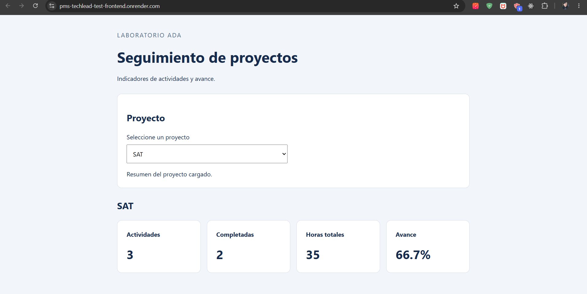
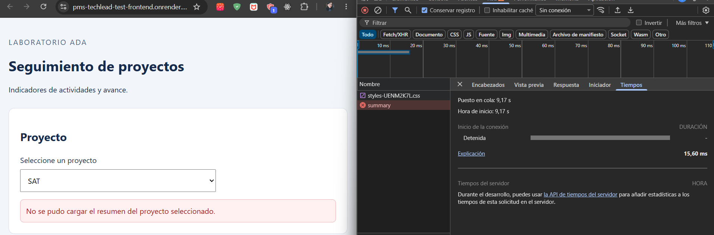

# Informe de entrega

- Repositorio: [GitHub](https://github.com/brittanypallasco2003/pms-techlead-test).
- Dashboard: [Render Static Site](https://pms-techlead-test-frontend.onrender.com).
- API: [Render Web Service](https://pms-techlead-test.onrender.com).
- Estado de la API: [Health](https://pms-techlead-test.onrender.com/health).
- Documentación API: [Swagger](https://pms-techlead-test.onrender.com/docs).

## Ejecución, build y pruebas

Requisitos: Python 3.12 y Node.js 22.12+ de la rama 22 o Node.js 24.
Comandos para PowerShell, desde la raíz:

```powershell
python -m venv .venv
.\.venv\Scripts\python.exe -m pip install -r requirements.txt
Copy-Item .env.example .env  # Solo la primera vez; configurar la base de prueba.
.\.venv\Scripts\python.exe -m scripts.seed
.\.venv\Scripts\python.exe -m uvicorn app.main:app --reload --host 127.0.0.1 --port 8000
```

En otra terminal, pruebas backend con mongomock, sin depender de Atlas:

```powershell
$env:MONGO_URL = 'mongodb://localhost:27017'
$env:DATABASE = 'ada_exam'
.\.venv\Scripts\python.exe -B -m pytest -q -p no:cacheprovider
```
La URI local evita la resolución DNS de Atlas al importar `app.database`.
Para el frontend, desde otra terminal:

```powershell
cd frontend
npm install
npm start      # http://localhost:4200
npm run build # dist/dashboard/browser
npm test      # Angular CLI + Vitest, sin watch
```

## Despliegue y configuración

| Elemento | Configuración |
|---|---|
| API en Render | Raíz del repositorio; Python 3.12; build: `pip install -r requirements.txt` |
| Arranque API | `uvicorn app.main:app --host 0.0.0.0 --port $PORT` |
| Angular en Render | Root Directory: `frontend`; Node.js 24; build: `npm ci && npm run build`; publicación: `dist/dashboard/browser` |
| Backend | `MONGO_URL`: URI privada de Atlas; `DATABASE`: nombre de la base; `ALLOWED_ORIGINS`: `https://pms-techlead-test-frontend.onrender.com` |
| Frontend | `environment.ts`: URL HTTPS pública de la API; `environment.development.ts`: `/api`, mediante el proxy local a `127.0.0.1:8000` |

`app/config.py` carga el `.env` de la raíz y da prioridad a las variables del
proceso. Los valores por defecto son MongoDB local, base `ada_exam` y origen
`http://localhost:4200`. `REPORT_TOKEN` pertenece al código heredado.

### Configuración de MongoDB Atlas

1. Creó un cluster en MongoDB Atlas.
2. Registró un usuario en Database Access con permisos
   sobre la base de datos de la aplicación.
3. Autorizó los rangos de IP de salida de Render
   en Network Access.
4. Obtuvo la cadena de conexión de MongoDB Atlas.
5. Configuró MONGO_URL y DATABASE en las variables
   de entorno del Web Service de Render.

## Hallazgos prioritarios

1. **Exposición de campos internos en el listado — corregido.**
   **Ubicación:** `app/main.py:list_projects` y `tests/test_api.py:test_list` en
   la versión heredada (`b98d9c6`). **Evidencia:** se devolvía el documento completo
   después de cambiar `_id` por `id`; la prueba solo comprobaba HTTP 200 y longitud.
   **Consecuencia:** exposición de `metadata`, `created_by` y otros campos, sin
   detectar incumplimientos del contrato. **Solución aplicada:** proyección en
   `app/projects/infrastructure/persistence/mongo_project_repository.py` y
   `response_model` en `app/projects/infrastructure/http/router.py`, con
   `budget: float` en `dtos/response/project_response.py` de ese módulo.
   **Verificación:** `tests/projects/infrastructure/http/test_projects_api.py:test_list`
   introduce campos internos y exige exactamente `id`, `name`, `budget`, `status`,
   los valores esperados y presupuesto numérico; pasó en esta revisión.

2. **Configuración fija que impedía usar el entorno — corregido.**
   **Ubicación:** `app/config.py` heredado. **Evidencia:** la configuración anterior
   mantenía los valores del archivo aunque se definieran `MONGO_URL` y `DATABASE`;
   la corrección está registrada en `9df5d0d`. **Consecuencia:** Render podía seguir
   apuntando a localhost en lugar de Atlas. **Solución aplicada:** leer variables
   con `os.getenv`, cargar `.env` con `override=False` y configurar CORS mediante
   `ALLOWED_ORIGINS`. **Verificación:** las tres pruebas de `tests/test_config.py`
   comprueban valores por defecto, carga de `.env` desde otro directorio y
   prioridad del entorno; todas pasaron.

## Verificación del flujo y las correcciones

Resultados verificados el 11 de octubre de 2026:

- Backend: **22 pruebas pasaron**, incluidos resumen correcto, proyecto inexistente
  (404), proyecto sin actividades, ID inválido (422), aislamiento entre proyectos
  y las correcciones de contrato y configuración.
- Frontend: **10 pruebas pasaron** con el ajuste temporal de Vitest indicado arriba.
  Ejercitan el componente y el adaptador HTTP productivos: indicadores, ceros,
  errores, cambio de proyecto y limpieza de tarjetas.
- Build: `npm run build` terminó correctamente y generó `dist/dashboard/browser`.
- Servicios públicos: dashboard, `/health`, `/projects` y los resúmenes devolvieron
  HTTP 200; también se comprobaron 404 y 422. La API permite el origen concreto del
  dashboard mediante CORS y el bundle Angular contiene la URL HTTPS de la API.

| Proyecto | Actividades | Completadas | Horas totales | Avance en el dashboard |
|---|---|---|---|---|
| SAT | 3 | 2 | 35 | 66.7% |
| Chatbots | 0 | 0 | 0 | 0% |

La captura siguiente muestra SAT en el dashboard desplegado con los valores que
devuelve la API. Junto con la configuración de Atlas confirmada por la autora,
documenta el flujo navegador → API → MongoDB Atlas.

## Dashboard






## Herramientas utilizadas y pendientes

Codex apoyó la creación del subagente `git-manager` de OpenCode, definido en
[.opencode/agents/git-manager.md](.opencode/agents/git-manager.md), para orientar
a los estudiantes en la gestión de ramas, la revisión de cambios y la creación
de commits con mensajes según Conventional Commits (`tipo(alcance): descripción`).
El subagente también incluye instrucciones para preparar y revisar pull requests.
Codex se utilizó además para revisar y actualizar este informe.

La verificación usó Git, Python/pytest, FastAPI TestClient, mongomock, Angular CLI,
Vitest, HttpTestingController y consultas HTTP a los servicios públicos.
